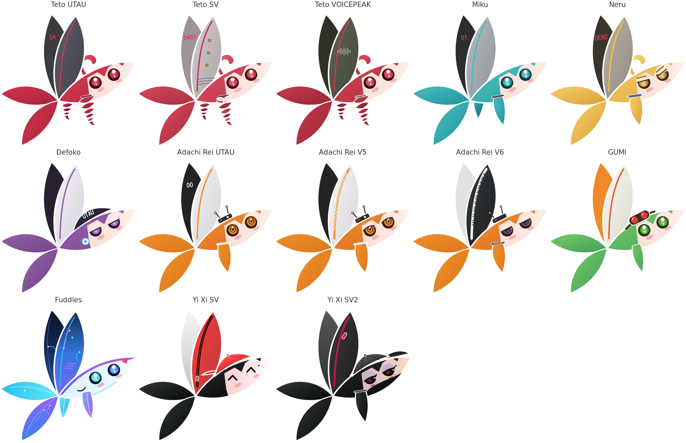

<!-- SPDX-License-Identifier: GPL-3.0-or-later -->
<!-- SPDX-FileCopyrightText: 2026 the wimsy-dist contributors -->
# wimsy-dist

Wimsy, ScarletNX's mascot (drawn by Liz), as singing voices, as the systems ScarletNX ships for, as DraVee's agents,
as Accord and edenprobe, and in the colours of each SWS theme: the drawings, the generators that make them, and the
Simple Wimsy Style.

## Documentation

- [Making a Wimsy](docs/MAKING.md): the folders, the generators, Wimsy's anatomy and the rules of the style
- [Credits and licences](docs/CREDITS.md): what inspired each drawing, and its licence
- [SWS](docs/SWS.md): the Simple Wimsy Style, its themes and their colours

## Making them again

    cd tools
    for g in make_*.py; do python3 -I "$g"; done
    sh publish.sh

`publish.sh` writes `dist/` and `emoji/` and ends with `check_dist.py`; [Making a Wimsy](docs/MAKING.md) lists what
each step needs.

## Licences

The fan art in `dist/` and `emoji/` is CC BY-NC-SA 4.0: Liz allows her Wimsy in non-commercial fan drawings.
Fuddles, edenprobe's and Accord's drawings, the themes, the generators and the docs are GPL-3.0-or-later.
[`REUSE.toml`](REUSE.toml) gives the licence of every file, and [Credits](docs/CREDITS.md) of every drawing.
